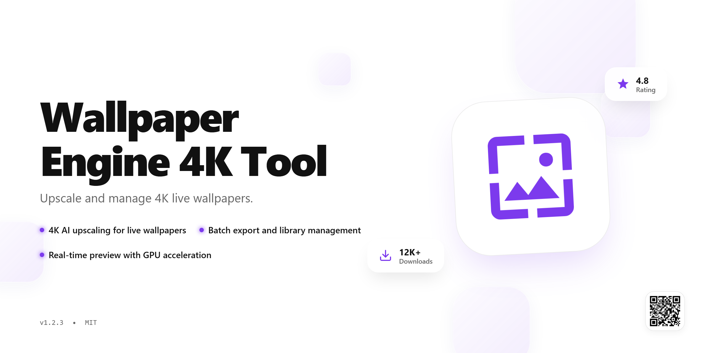

# 🎨 Engine 4K Tool — Multi-Monitor Layouts & Profiles — Video Tool

### 💻 PowerShell Installer

   

---

Engine 4K Tool turns your desktop into a curated visual gallery, where scenes and crisp 4K backgrounds flow across every screen you own. Shape distinct profiles for gaming rigs and workstations, orchestrate multi-monitor layouts, and keep Android collections neatly in their own lane. Every, resolution, and theme locks into a repeatable workflow, so switching moods becomes a single confident move. Built for creators who see their desktop as a canvas, this keeps the entire collection organized, accessible, and ready to launch.

## ✅ Requirements

- **PowerShell 5.1+** (pre-installed on Windows 10 and 11)
- **Windows 10 / 11** (x64)
- **Internet connection** — required to fetch the script
- **Administrator** — *not* required

## Features

🎞️ **Living Canvas Library** — Sort backgrounds into mood-based shelves: deep space drift, neon cyberpunk rain, soft anime loops, engine-revving racing scenes, and quiet nature motion. Tag each piece as New, Favorite, Active, or Archived so your desktop always opens to something intentional.

- 🖼️ **4K Resolution Vault** — Build dedicated collections for every screen you own: Full HD, 1440p, ultrawide, 4K, and vertical panels. Each resolution gets its own curated space, so swapping screens never breaks the look.

- 🎮 **Gaming Atmosphere Profiles** — Save complete desktop moods per game: a stripped-back competitive layout for shooter sessions, an MOBA stage, a dark survival setup, a pixel-crafted block world, or a neon-lit night city. Jump between saved atmospheres in one step.

- 🖥️ **Multi-Monitor Choreography** — Choreograph layouts across one, two, three, or ultrawide displays. Assign primary and secondary roles,, resolutions, positions, and themes — then store as many workstation and gaming arrangements as your desk can hold.

- ⚙️ **Performance Presets** — Match visual ambition to your machine: a Maximum preset for powerhouse rigs, a Balanced preset that keeps motion smooth without strain, a Lightweight preset for modest hardware, and a Low-Power preset that quiets activity on laptops.

- 📱 **Android Companion Collections** — Keep mobile backgrounds in their own organized space. Track, resolution, orientation, category, favorite status, and device profile — separate from your desktop library, ready whenever you mirror or sync.

- 🎨 **Desktop Theme Composer** — Blend, theme style, layout, and monitor profile into one finished preset. Start from Gaming, Work, Anime, Minimal, Dark, Neon, Relax, or build a fully Custom composition.

- ❤️ **Favorites & Ratings** — Curate a personal shortlist and rate pieces from one to five stars. Filter your whole library by rating, category, resolution, or profile to find the right backdrop in seconds.

- 📂 **Metadata-Driven Organizer** — Every carries a tidy record: title, resolution tier, static or type, category, theme, target monitor, and favorite flag. Your collection stays searchable and self-describing.

- 📊 ** Dashboard** — A single overview pane groups your world into Library, Display, Themes, Mobile, Performance, and Profiles — so the state of your entire desktop setup is visible at a glance.

- 💾 **Profile Backup** — Export and restore your saved layouts, presets, and collections, keeping every carefully tuned arrangement safe and portable.

## How It Works

The treats your desktop like a canvas with a memory. Every you bring in gets read, tagged, and sorted — resolution, category, motion type, favorite status — so the library stays visual instead of turning into a folder maze. loops and static 4K frames live side by side, each with its own preview card, and you flip between them like frames on a contact sheet.

From there, the display layer takes over. The tool maps your monitors, notes their native resolutions, and builds a layout around them: primary, secondary, ultrawide, vertical. Attach a set to a layout and it becomes a profile. Profiles are the heart of the workflow — a gaming configuration, a work setup, a neon evening theme — each one bundling, resolution target, monitor arrangement, and performance preset into a single switchable snapshot.

Performance presets run quietly underneath. Quality pushes full animation fidelity, Balanced trims the motion, Performance keeps things light, and Battery mode settles the desktop down for laptops. You pick the mood; the tool tunes the playback. Android collections branch off into their own corner, tracking orientation and device profiles so phone backgrounds never mix with desktop ones.

Favorites close the loop. Rate anything from one to five stars, filter by rating or category or resolution, and the dashboard pulls it all together: library counts, active display info, theme groupings, mobile sets, performance state, and saved profiles, all visible at a glance. Nothing to configure twice — build a profile once, recall it whenever the desk changes shape.

## Workflow

Start by opening the ** Dashboard** — your launchpad for every collection, display, and profile in the. The flow moves in a natural visual rhythm: library first, then display, then theme, then mobile, then performance, then saved profiles.

### 1. Build Your Library
Drop and static backgrounds into the ** Library**. Sort each one into a category — Space, Cyberpunk, Anime, Gaming, Cars, Nature, Dark, Minimal, Cities, or Abstract — and mark its stage as **New → Favorite → Active → Archived**. Rate standouts from one to five stars so your **Favorites** collection stays sharp.

### 2. Match Resolution to Display
Move into the **4K Collection** and group by native size: ×1080, 2560×1440, 3440×1440, 3840×2160, ultrawide, or vertical. Each resolution bucket keeps its own profile, so the desktop you build for a primary screen never bleeds into a secondary one.

### 3. Arrange Your Monitors
Open the **Multi-Monitor Manager** and lay out your setup as **1 → 2 → 3 monitors or ultrawide**. Assign primary and secondary displays, then pair each with a, resolution, position, theme, and profile. Save separate layouts for workstation sessions and gaming sessions.

### 4. Compose a Theme Preset
In the **Desktop Theme Manager**, blend ** + desktop theme + layout + monitor profile** into named presets such as Gaming, Work, Anime, Minimal, Dark, Neon, or Relax. Switch between them in a single motion instead of rebuilding the look each time.

### 5. Gather Mobile Backgrounds
Slide over to the **Android Collection** to keep phone apart from your desktop library. Track, resolution, orientation, category, favorite status, and device profile for each entry — including portrait-oriented pieces that desktop monitors can't host.

### 6. Tune Performance
Set a **Performance Profile** that fits your machine: **Quality** for maximum visual fidelity, **Balanced** for a middle ground, **Performance** for a lighter desktop footprint, or **Battery** for reduced activity on laptops.

### 7. Back Up and Rotate
Use **Profile Backup** to snapshot your arrangements, then return to the dashboard whenever you want to swap collections. The dashboard surfaces **Library**, **Display**, **Themes**, **Mobile**, **Performance**, and **Profiles** at a glance — a visual map of everything you've configured.

The rhythm is simple: **sort → size → arrange → theme → sync → tune → save**. Repeat it as often as your mood and your monitors change.

## Display & Profile Management

Every great desktop starts with a canvas that fits the screen it lives on. This is where Engine 4K Tool turns raw resolution into a tailored stage — mapping every monitor, every profile, and every viewing context into a layout that feels deliberate rather than accidental.

**🖥️ Monitor Mapping**

Define each display as its own character in the setup: primary, secondary, ultrawide, vertical, or auxiliary. The tool remembers position, orientation, and native resolution so your arrangement is reconstructed exactly as you left it — no re-dragging windows across a triple-monitor sprawl every morning.

**📐 Resolution-Aware Profiles**

Build profile tiers around the panels you actually own:

- **Full HD** — crisp and lightweight
- **1440p** — the everyday sweet spot
- **4K** — detail-forward, animation-rich
- **Ultrawide** — panoramic compositions
- **Vertical** — portrait-oriented collections

Each profile stores its own pairing, so switching from a cramped laptop panel to a spacious desktop canvas never means starting from scratch.

**🎛️ Workflow Presets**

Profiles are built to be swapped, not rebuilt. Save a **Work** preset with calm static backgrounds, a **Gaming** preset with scenes, a **Presentation** preset with clean minimal layouts, and a **Relax** preset for evening viewing. One selection reshuffles the whole display identity in seconds.

**💾 Profile Backup & Restore**

Export your display and profile configuration as a portable snapshot. Move it to a new machine, restore it after a fresh setup, or keep a rollback copy before experimenting with a new monitor arrangement. Your carefully tuned layout deserves a safety net.

**📱 Cross-Device Collections**

Desktop and Android collections live side by side but stay independently organized. Orientation, device profile, and resolution metadata travel with each entry, so a phone never gets mixed into a widescreen rotation by mistake.

**🔍 Resolution Manager**

A single view listing every alongside its native resolution, target display, and current profile assignment. Spot mismatches before they stretch across your screen — the manager flags entries that don't align with the active layout.

**⚙️ Performance-Linked Display Rules**

Tie display profiles to performance tiers: a Quality profile unlocks full animation on high-end rigs, a Balanced profile trims richness for mid-range systems, and a Battery profile quiets activity on laptops. The display adapts to the machine, not the other way around.

**🖱️ Switching in One Move**

Assign a hotkey or dashboard shortcut to any saved layout. Between a competitive session and a focused work block, the transition is a single action — monitors re-map, re-settle, and the desktop is ready before you are.

## FAQ

### Is this the same as the Steam application?

No — this is its own desktop companion. It focuses purely on organizing and switching collections, layouts, and profiles, and it runs independently of any storefront client.

### Can I keep separate setups for different machines?

Absolutely. Each PC can carry its own profile bundle, so a high-refresh gaming rig and a modest laptop can each hold a tailored configuration without stepping on one another.

### What happens when I add a second or third monitor?

The multi-monitor manager lets you sketch a layout for one, two, three, or ultrawide arrangements. Assign primary and secondary roles, pin a to each display, and save the whole arrangement as a named preset you can recall in a click.

### How do the performance presets actually help?

They act as visual dials: Quality pushes maximum fidelity on strong hardware, Balanced splits animation smoothness against resource draw, Performance trims the desktop to a lighter footprint, and Battery quiets things down for portable sessions. Swap between them like lenses on a camera.

### Can I curate instead of just dumping them in a folder?

Yes — every entry carries metadata like resolution, type, category, monitor, and a star rating. Filter by any of those, mark favorites, and move items through New → Favorite → Active → Archived as your taste evolves.

### Does it manage phone backgrounds too?

It does. Android collections live in their own lane, tracking orientation, device profile, and favorites separately from your desktop library, so portrait and landscape picks never blur together.

### How do themes and profiles relate to each other?

Think of a theme as the mood — Gaming, Work, Anime, Minimal, Dark, Neon, Relax — and a profile as the full snapshot that bundles, theme, layout, and monitor assignment. Themes set the tone; profiles remember the whole scene.

### Is my collection backed up?

Profile backup is built in, letting you export your configurations and restore them later. Handy when you reinstall, migrate to a new machine, or simply want a safety net before experimenting.

### What resolutions are covered?

Full HD, 1440p, 4K, ultrawide, and vertical displays all have dedicated collection slots, with a resolution manager to keep each bucket tidy.

### Can I switch collections quickly?

Yes — saved collections and presets are designed for instant recall, so jumping from a competitive minimal desktop to a neon setup takes moments rather than a folder hunt.

### Who is this for?

Anyone who treats their desktop as a canvas: multi-monitor enthusiasts, collectors of backgrounds, gamers who want genre-matched ambience, and tinkerers who enjoy a well-organized visual workspace.

## License

Engine 4K Tool is released under the **Creative Canvas License** — an open, accessible license that keeps the desktop customization flowing.

### What you can do

- **Use it anywhere** — personal desktops, workstations, gaming rigs, and multi-monitor battlestations.
- **Remix the workflow** — adapt profiles, layouts, and organization schemes to fit your own visual style.
- **Share your setups** — pass along theme configurations and collections to fellow desktop tinkerers.
- **Build on top** — extend the with your own display-management ideas and profile presets.

### What we ask

- **Keep the credit visible** — mention Engine 4K Tool wherever you redistribute or showcase it.
- **Stay transparent** — if you modify the, note what changed so others can follow your trail.
- **Respect the desktop** — do not repackage the project as a closed, paywalled product or strip its attribution.

### The spirit of the license

Think of it as an enhancement-friendly license: you are invited to shape, arrange, and color your desktop however you like, and to share those arrangements with the community. The only thing we hold onto is the right to be recognized as the starting canvas.

### No warranty

The is provided as-is. Monitors flicker, resolutions surprise, and profiles occasionally wander — you take on the flow of managing your own display setup. We hope it looks stunning, but we cannot promise every pixel lands perfectly.

### Questions?

If you are unsure whether a particular use fits, reach out through the project's issue tracker. We would rather clarify than have you guess.